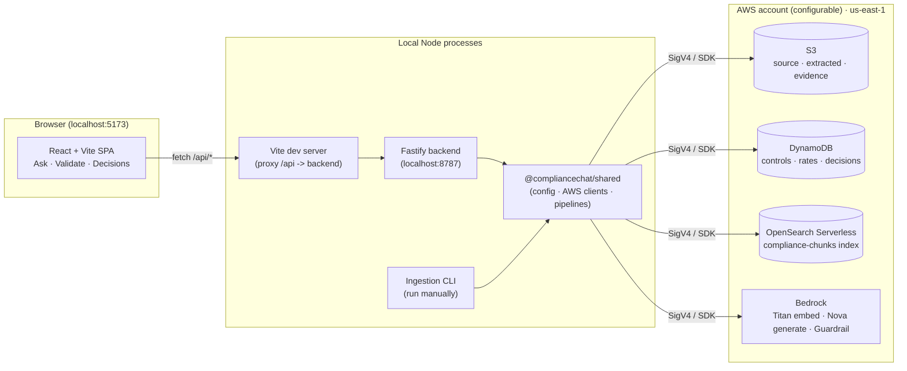
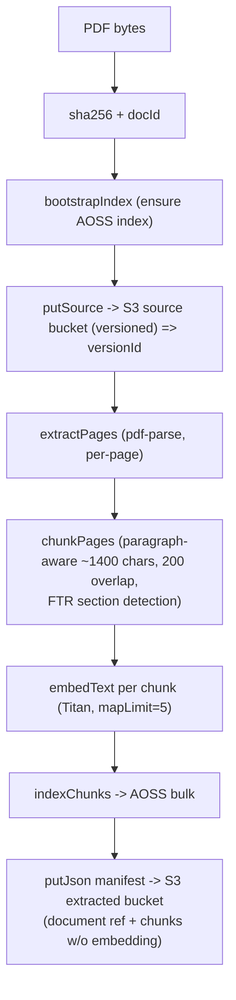
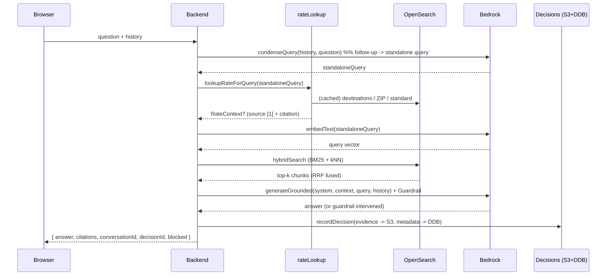
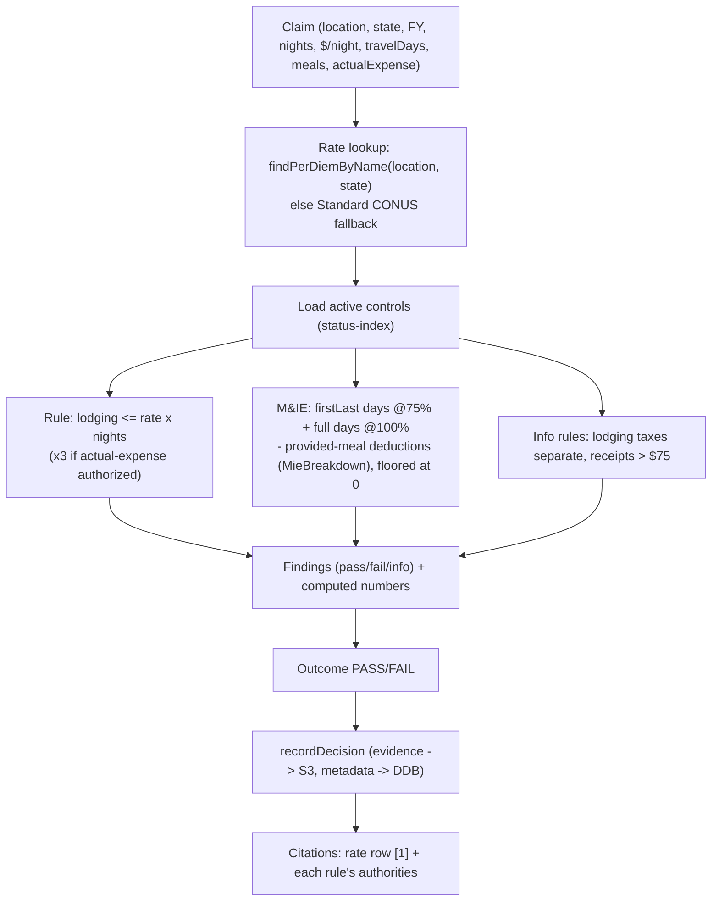

# ComplianceChat — Architecture

A **local-only** prototype that answers U.S. federal travel / per‑diem **compliance** questions
(RAG over the Federal Travel Regulation) and **validates travel claims** against structured GSA
per‑diem data. It runs entirely from Cursor on `localhost`, talks to **real AWS services**, and is
never deployed.

> Scope note: this document describes the system as built. It is intentionally detailed and is the
> source of truth for how the pieces fit together. For setup and commands, see `README.md`.

---

## 1. Goals and non‑goals

### Goals
- Answer per‑diem/FTR questions with **grounded, cited** answers (no hallucinated rules).
- Resolve **exact per‑diem rates** by city, state, or ZIP code from authoritative GSA data.
- **Validate a travel claim** deterministically (lodging ceiling, M&IE, provided‑meal deductions)
  with a full citation trail.
- Produce an **auditable decision record** for every answer and validation.
- Keep all AWS access server‑side; the browser never sees credentials.

### Non‑goals / constraints
- **No deployment / IaC.** No ECS, Fargate, Amplify, ALB, Cognito, Step Functions, Dockerfiles,
  or infrastructure-as-code. Everything runs locally.
- **No long‑lived keys.** Credentials come from the AWS default credential provider chain (an IAM
  Identity Center / SSO profile or a local named profile). `.env` holds only non‑secret config.
- **Fixtures never silently replace AWS.** Labeled offline fixtures exist for dev/tests, but a
  failing AWS call surfaces as an error — it is never masked by a fixture.

---

## 2. High‑level view



Only the **backend** and **ingestion CLI** touch AWS, both through the shared package. The frontend
talks exclusively to the backend via the Vite dev proxy.

---

## 3. Monorepo layout

npm **workspaces** monorepo, ESM throughout, TypeScript run directly with `tsx`.

```
ComplianceChat/
├─ package.json                 # workspaces + dev scripts (concurrently, tsx, vitest)
├─ tsconfig.base.json           # ES2022, NodeNext/Bundler resolution, strict
├─ .env / .env.example          # runtime config (no secrets); example has placeholders only
├─ README.md / ARCHITECTURE.md
├─ data/                        # source docs: FTR PDF, GSA per-diem xlsx, GSA ZIP xlsx
├─ eval/cases.jsonl             # evaluation cases
├─ fixtures/                    # clearly-labeled offline fixtures
└─ packages/
   ├─ shared/      @compliancechat/shared   # the engine: config, AWS clients, pipelines, types
   │  └─ src/
   │     ├─ config.ts            # typed AppConfig from .env (app vs ingestion profile)
   │     ├─ logger.ts
   │     ├─ types.ts             # all domain types + zod schemas
   │     ├─ check.ts             # live connectivity/permission checks
   │     ├─ aws/
   │     │  ├─ clients.ts        # S3 / DynamoDB(Document) / Bedrock / OpenSearch(SigV4 aoss)
   │     │  ├─ s3.ts             # putSource(versioned) · putJson · getJson · bucketReachable
   │     │  ├─ dynamo.ts         # controls · rates(perdiem/mie/zip) · decisions repos
   │     │  ├─ bedrock.ts        # embedText(Titan) · generateGrounded(Converse+guardrail) · generatePlain
   │     │  └─ opensearch.ts     # bootstrapIndex · indexChunks · hybridSearch(RRF) · getChunkById
   │     └─ pipeline/
   │        ├─ chunking.ts(+test)# page -> paragraph-aware chunks (FTR section detection)
   │        ├─ retrieval.ts      # condenseQuery · retrieve · toCitations · renderContext
   │        ├─ rateLookup.ts     # detect location/ZIP in a question -> structured rate (chat)
   │        ├─ answer.ts         # multi-turn RAG orchestration
   │        ├─ compliance.ts     # deterministic claim validation engine
   │        └─ decisions.ts      # write evidence(S3) + metadata(DynamoDB)
   ├─ ingestion/   @compliancechat/ingestion # manual local CLI (commander)
   │  └─ src/
   │     ├─ cli.ts               # bootstrap · ingest · seed · seed-perdiem · seed-zip · check · eval · ask · validate
   │     ├─ pdf.ts               # pdf-parse page extraction
   │     ├─ xlsx.ts              # GSA per-diem flat-file parser (keyed by city+state)
   │     ├─ xlsxZip.ts           # GSA ZIP crosswalk parser (max monthly lodging)
   │     └─ commands/*.ts        # one file per command
   ├─ backend/     @compliancechat/backend   # Fastify API (localhost only)
   │  └─ src/
   │     ├─ server.ts            # bind host/port, error handler, route registration
   │     └─ routes/              # health · chat · validate · decisions · chunks · rates
   └─ frontend/    @compliancechat/frontend  # React + Vite SPA
      └─ src/
         ├─ api.ts · types.ts
         └─ components/          # Chat · Validate · Decisions · Citations · App
```

### Package dependency direction
`frontend → (HTTP) → backend → shared → AWS`, and `ingestion → shared → AWS`. `shared` has no
dependency on backend/frontend/ingestion. Types used by the frontend are duplicated in
`frontend/src/types.ts` (the browser never imports `shared`, keeping AWS SDKs out of the bundle).

---

## 4. Runtime components

### 4.1 Frontend (`packages/frontend`)
- React + TypeScript SPA built with **Vite**, served at `http://localhost:5173`.
- `vite.config.ts` loads the repo‑root `.env` and **proxies `/api` → backend** (`BACKEND_HOST:BACKEND_PORT`).
- Three tabs:
  - **Ask** — multi‑turn chat thread; sample prompt chips; renders answers with clickable,
    expandable **citations** (fetches full chunk text on expand).
  - **Validate** — a **form** (not JSON) for a travel claim, with a **ZIP lookup** and a
    **destination autocomplete** that auto‑fills state; shows the computed breakdown + findings.
  - **Decision records** — recent decisions from the audit trail.
- A health badge polls `/api/health/aws`.

### 4.2 Backend (`packages/backend`)
- **Fastify**, binds to `127.0.0.1:8787` (localhost only — never `0.0.0.0`).
- Constructs **one** set of AWS clients at startup (`makeClients(cfg)`) and shares them across
  requests.
- Central error handler maps thrown errors to `{ error }` with an optional `statusCode`.
- Routes are thin: validate input, call a `shared` pipeline function, return JSON.

### 4.3 Ingestion CLI (`packages/ingestion`)
- **commander** CLI, run manually via `npm run …`, using the **ingestion** AWS profile.
- Performs all the “write” side work: create the index, ingest PDFs, load rates, seed controls,
  check connectivity, and run evaluations. Also has `ask`/`validate` for quick terminal testing.

### 4.4 Shared engine (`packages/shared`)
- The only place that imports AWS SDKs. Exposes typed config, AWS client factory, the AWS repos,
  and the RAG/compliance/decision pipelines. Used by both backend and ingestion.

---

## 5. AWS services and resources

All in a single AWS account, region **`us-east-1`** (account and region both configurable via
`.env`). Resource names in this doc (e.g. `compliancechat-*`) are examples. Clients are created
with `defaultProvider({ profile })` — no static keys. OpenSearch is signed with **SigV4** using the
`aoss` service name.

### 5.1 S3 — three buckets
| Bucket (configurable) | Purpose | Notes |
|---|---|---|
| `S3_SOURCE_BUCKET` | Original source docs (FTR PDF, GSA xlsx) | **Versioning on**; `putSource` returns the `versionId` used as the document version |
| `S3_EXTRACTED_BUCKET` | Extracted/normalized JSON manifests | One manifest per `docId/versionId` |
| `S3_EVIDENCE_BUCKET` | Decision evidence JSON | Immutable per‑decision record under `decisions/<date>/<id>.json` |

### 5.2 DynamoDB — three on‑demand tables
| Table | Partition/Sort | GSI | Item kinds & key patterns |
|---|---|---|---|
| `DDB_CONTROLS_TABLE` | `pk` / `sk` | `status-index` (query active controls) | Compliance controls (rule definitions + authorities) |
| `DDB_RATES_TABLE` | `pk` / `sk` | — | Per‑diem: `pk=PERDIEM#<FY>#<CITY, ST>`; M&IE breakdown: `pk=MIE#CONUS`; ZIP crosswalk: `pk=ZIP#<FY>#<zip>` |
| `DDB_DECISIONS_TABLE` | `pk` / `sk` | `created-index` (`entityType=DECISION`, sorted by `createdAt`) | Decision metadata + pointer to evidence in S3 |

Notes:
- Per‑diem rows are keyed by **city + state** (e.g. `DALLAS, TX` vs `DALLAS, IA`) so same‑named
  cities in different states are never merged.
- ZIP rows store **lodging only** (max across the 12 monthly columns); M&IE is joined from the
  destination row at query time.

### 5.3 OpenSearch Serverless — one index
- Collection endpoint via `AOSS_COLLECTION_ENDPOINT`; index name `AOSS_INDEX`
  (default `compliance-chunks`). **Public network endpoint**, but access is tightly scoped by IAM +
  data‑access policies (public reachability ≠ anonymous access).
- Index mapping (`bootstrapIndex`): keyword/text metadata fields + a **`knn_vector`** `embedding`
  field:
  - `dimension = BEDROCK_EMBED_DIM` (1024)
  - method `hnsw`, `space_type = cosinesimil`, `engine = faiss`, `ef_construction=256`, `m=16`.

### 5.4 Bedrock
| Role | Model (configurable) | API |
|---|---|---|
| Embeddings | `amazon.titan-embed-text-v2:0` (1024‑dim, normalized) | `InvokeModel` |
| Generation | `us.amazon.nova-pro-v1:0` (inference profile) | `Converse` + Guardrail |
| Evaluation judge | `BEDROCK_EVAL_MODEL_ID` (Nova) | `Converse` (no guardrail) |
| Guardrail | `BEDROCK_GUARDRAIL_ID` / `_VERSION` | contextual grounding + relevance |

The guardrail runs **contextual grounding**: the retrieved context is sent as a `grounding_source`
guard‑content block and the question as a `query` block, so grounded answers pass and ungrounded
ones are intervened.

---

## 6. Core data model (`shared/src/types.ts`)

- **SourceDocumentRef** — `docId`, `title`, `sourceUri`, `s3VersionId`, `sha256`, `edition`, `ingestedAt`.
- **Chunk / IndexedChunk / RetrievedChunk** — chunk text + metadata; indexed variant adds the
  `embedding`; retrieved variant adds `score`, `lexicalRank`, `vectorRank`.
- **Citation** — `chunkId`, `docId`, `docTitle`, `version`, `sourceUri`, `page`, `section`, `score`,
  `snippet`. (Document chunks have a real `chunkId`; synthesized rate/authority citations use a
  `docId:label` id, which the UI treats as non‑expandable.)
- **PerDiemRate** — `pk/sk`, `fiscalYear`, `state`, `location`, `lodging`, `mie`, `isStandard`,
  `authority`.
- **ZipPerDiemRate** — `pk/sk`, `fiscalYear`, `zip`, `destinationId`, `name`, `state`, `county`,
  `lodging`, `authority`.
- **MieBreakdown** — CONUS per‑meal deduction rows (breakfast/lunch/dinner + first/last‑day amount).
- **ControlSchema / Control** (zod) — a compliance rule: `ruleKey`, `status`, `title`, `authority[]`.
- **ClaimSchema / Claim** (zod) — the validation input (location, state, FY, nights, lodging/night,
  travelDays, providedMeals, actualExpenseAuthorized).
- **RuleFinding / ValidationResult** — per‑rule pass/fail/info + the computed numbers + citations.
- **ConversationMessage / ChatResult** — multi‑turn chat I/O (conversationId, decisionId, answer,
  citations, blocked, standaloneQuery).
- **DecisionRecord / DecisionEvidence** — the audit trail (metadata + full evidence payload).

---

## 7. Ingestion pipeline (documents)

Command: `npm run ingest -- <file.pdf> --doc-id … --title … --edition … --source-url …`



- **Versioning**: the S3 object `versionId` becomes the document `version` (unless `--edition` is
  given), so every chunk is traceable to an exact source revision.
- Only PDF ingestion is implemented; the manifest stores chunk metadata (minus embeddings) for
  provenance.

### 7.1 Rate loading (structured data)
- `seed-perdiem <xlsx> --fiscal-year <FY> [--upload]` → parse GSA flat file, collapse seasonal rows
  to one per **city+state** (max lodging), write `PERDIEM#<FY>#<CITY, ST>` rows. Optionally uploads
  the source xlsx to the versioned source bucket.
- `seed-zip <xlsx> [--fiscal-year <FY>]` → parse the ~40k‑row ZIP crosswalk, take the **max** of the
  12 monthly lodging columns per ZIP, batch‑write `ZIP#<FY>#<zip>` rows (25/batch, bounded
  concurrency, unprocessed‑item retry).
- `seed` → load compliance controls + sample per‑diem/M&IE fixtures.

---

## 8. RAG chat pipeline (`answer.ts` + `retrieval.ts` + `rateLookup.ts`)

Endpoint: `POST /api/chat` with `{ question, conversationId?, history?, k? }`.



Key behaviors:
- **Query condensation**: a follow‑up ("what about there?") is rewritten into a standalone query
  using history (`generatePlain`), so retrieval and rate lookup work across turns.
- **Structured rate injection**: if the question is rate‑related and names a location/ZIP, the real
  rate is pulled from DynamoDB and injected as grounding **source `[1]`** (ahead of document
  chunks), with its own citation. This lets the model answer with exact numbers, not just FTR prose.
- **Grounded generation**: the system prompt restricts the model to the numbered sources, forbids
  adding uncited examples/qualifiers, and requires verbatim rates/section numbers. The guardrail
  enforces contextual grounding on top.
- **Every turn is a decision record** under one `conversationId`.

### 8.1 Hybrid retrieval (`hybridSearch`)
Two queries run in parallel and are fused with **Reciprocal Rank Fusion** (no reliance on a
server‑side hybrid pipeline, so it is robust across OpenSearch versions):
- **Lexical**: `multi_match` over `text^2`, `section`, `docTitle`.
- **Vector**: `knn` over the `embedding` field.
- **RRF**: each result contributes `1 / (C + rank)` with `C = 60`; scores summed per `chunkId`;
  top‑`k` returned (pool size `max(3k, 12)`). Embeddings are stripped before returning.

### 8.2 Rate resolution (`rateLookup.ts`, and `findPerDiemByName` in `dynamo.ts`)
Resolution order and rules:
1. **ZIP code** in the question → `ZIP#<FY>#<zip>` → join M&IE from the destination row.
2. **Known destination** mentioned in the text — matches the whole name **and** each
   slash‑separated fragment (GSA groups areas like "Atlantic Beach / Morehead City"); **longest**
   fragment wins (“wildcard” match).
3. **State disambiguation** — if the question names a state (full name, or uppercase abbreviation as
   a standalone token to avoid matching words like "in"/"or"/"me"), that destination is preferred
   (so "Dallas TX" beats "Dallas IA").
4. **Standard CONUS** fallback when the question asks about the standard/CONUS rate.
- The destination list is **cached in‑process (10‑min TTL)** so the 40k‑row rates table is not
  scanned on every chat turn.
- Fiscal year is detected from the question (e.g. "FY2026", "2027"), defaulting to **FY2027**.

---

## 9. Compliance validation pipeline (`compliance.ts`)

Endpoint: `POST /api/validate` with a `ClaimSchema`‑validated body. This is a **deterministic
engine** (no LLM), so results are reproducible and fully explainable.



Computation details:
- **Lodging**: `claimedLodging = nights × costPerNight`; max reimbursable = `lodgingRate × nights`,
  ×3 if `actualExpenseAuthorized`. PASS if within max (± epsilon), else FAIL.
- **M&IE**: first/last day count = 1 if a single travel day else 2, each paid at 75% (from the
  breakdown table, or `mie × 0.75` fallback); full days = `max(0, travelDays − 2)` at 100%;
  provided‑meal deductions from `MIE#CONUS`; total floored at 0.
- **Citations**: the exact **per‑diem rate row** used is cited as `[1]` (destination, lodging, M&IE,
  FY, GSA source; notes when the Standard CONUS fallback was applied), followed by each rule's
  authorities.

---

## 10. Decision records (audit trail) — `decisions.ts`

Every chat turn and validation writes a decision:
- **Evidence (S3)** — full JSON to `S3_EVIDENCE_BUCKET` at `decisions/<YYYY-MM-DD>/<decisionId>.json`:
  the input, the retrieved chunks, the exact prompt (system + grounding + query), the raw model
  output, the guardrail trace, and the result.
- **Metadata (DynamoDB)** — queryable record in `DDB_DECISIONS_TABLE` with `entityType=DECISION`
  (for the `created-index` GSI), `type`, `createdAt`, `conversationId?`, `query`, `outcome`,
  `citations`, `evidenceUri`, and the `model`/guardrail identifiers used.

This makes any answer reproducible and reviewable after the fact.

---

## 11. API surface (backend)

| Method & path | Purpose |
|---|---|
| `GET /api/health` | Liveness |
| `GET /api/health/aws` | Live S3 / DynamoDB / Bedrock / OpenSearch checks |
| `POST /api/chat` | Multi‑turn RAG answer (`{question, conversationId?, history?, k?}`) |
| `POST /api/validate` | Deterministic claim validation (`ClaimSchema`) |
| `GET /api/decisions` | Recent decision records |
| `GET /api/decisions/:id?evidence=1` | One decision (optionally with full evidence) |
| `GET /api/chunks/:id` | Full chunk text + metadata (for citation “read more”) |
| `GET /api/rates/destinations?fiscalYear=` | Destination list for the Validate autocomplete |
| `GET /api/rates/zip?fiscalYear=&zip=` | Resolve a ZIP → destination + lodging + joined M&IE |

---

## 12. Configuration (`.env`)

Loaded once from the repo root by `shared/src/config.ts` (walks up to find `.env`). `getConfig("app"
| "ingestion")` returns a typed `AppConfig`; the **ingestion** runtime uses `AWS_PROFILE_INGEST`
(falling back to `AWS_PROFILE`). `.env.example` contains **placeholders only**.

Keys: `AWS_REGION`, `AWS_PROFILE`, `AWS_PROFILE_INGEST`, `S3_{SOURCE,EXTRACTED,EVIDENCE}_BUCKET`,
`DDB_{CONTROLS,RATES,DECISIONS}_TABLE`, `AOSS_COLLECTION_ENDPOINT`, `AOSS_INDEX`,
`BEDROCK_{EMBED_MODEL_ID,EMBED_DIM,GENERATION_MODEL_ID,EVAL_MODEL_ID,GUARDRAIL_ID,GUARDRAIL_VERSION}`,
`BACKEND_HOST`, `BACKEND_PORT`, `FRONTEND_PORT`.

---

## 13. Security model

- **No credentials in the browser.** The SPA only calls the backend; AWS SDKs are never bundled
  into the frontend.
- **Default credential provider chain** with an IAM Identity Center / named profile. No long‑lived
  access keys in code, config, or source control.
- **Localhost binding.** Backend listens on `127.0.0.1`; frontend reaches it via the Vite proxy.
- **OpenSearch**: public network endpoint, but scoped by IAM + data‑access policies and SigV4‑signed
  (`aoss`). Public reachability is not anonymous access.
- **Guardrail**: contextual‑grounding policy on generation; the whole interaction (including the
  guardrail trace) is persisted for audit.
- **Least privilege (future)**: the app and ingestion runtimes already use separate profile *names*;
  splitting them into least‑privilege roles is a documented next step.

---

## 14. Developer workflow

```bash
npm install                 # install all workspaces
npm run dev                 # frontend :5173 (proxy) + backend :8787 (concurrently)
npm run bootstrap           # create the OpenSearch index
npm run seed                # controls + sample per-diem/M&IE
npm run seed:perdiem -- "<xlsx>" --fiscal-year 2027   # load GSA per-diem flat file
npm run seed:zip -- "<xlsx>"                          # load GSA ZIP crosswalk
npm run ingest -- data/<doc>.pdf --doc-id … --title …  # ingest a PDF
npm run check               # live AWS connectivity + permissions
npm run eval                # run evaluation cases end-to-end
npm run typecheck           # tsc across all packages
npm run test                # vitest (unit tests, e.g. chunking)
```

The backend runs under `tsx watch`, so edits to `shared` hot‑reload the API (and reset in‑process
caches such as the rate‑lookup destination cache).

---

## 15. Offline fixtures and evaluation
- `fixtures/` holds **clearly labeled** sample data (e.g. `retrieval.sample.json`) for offline UI
  work and unit tests. They are never used to silently stand in for a failing AWS call.
- `eval/cases.jsonl` drives `npm run eval`, which runs the real pipeline end‑to‑end and uses a
  Bedrock judge model (`generatePlain`, no guardrail) to score answers.

---

## 16. Known limitations / future work
- **M&IE floor**: the engine floors total M&IE at `$0` rather than preserving the daily incidentals
  portion when deductions exceed the meal allowance — a known simplification.
- **Seeded sample rates** (`packages/ingestion/seed/`) are fixtures; authoritative rates come from
  the loaded GSA xlsx files (and could be wired to the live GSA Per Diem API).
- **Ambiguous bare city** (e.g. "per diem in Dallas" with no state) resolves to one match; could
  prompt the user to disambiguate by state.
- **Least‑privilege IAM roles** for app vs ingestion are not yet split out.
- **Scans on the rates table**: destination/name lookups scan the (large) rates table; a `type`/FY
  GSI would make these queries instead of scans if needed at larger scale.
- Only **PDF** document ingestion is implemented.
```
